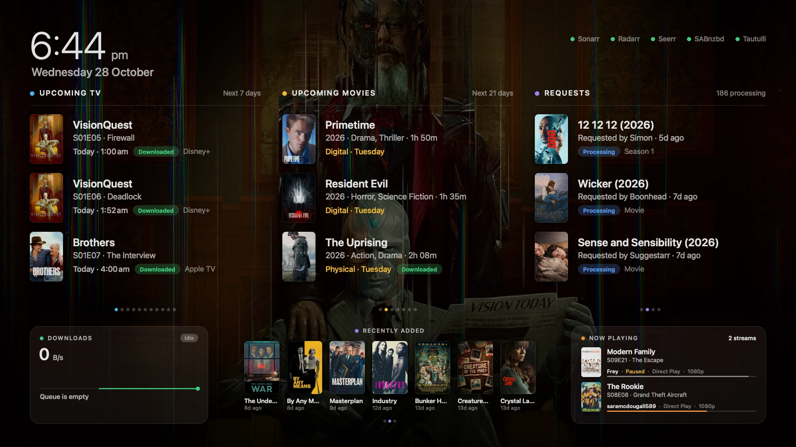

# Screensaverr

A native macOS screen saver for your media server. While your Mac is idle it shows:

- **Upcoming TV** from **Sonarr**: what airs today, tomorrow and this week, with posters. Season drops are grouped ("S01E01–E08"), and premieres, finales and already-downloaded episodes are tagged.
- **Upcoming movies** from **Radarr**: each movie's next release (in cinemas, digital or physical).
- **Requests** from **Seerr** (Overseerr and Jellyseerr work too): who asked for what, and whether it's pending, processing or available.
- **Recently Added** from **Seerr**: a row of posters for what was most recently added to your library.
- **Downloads** from **SABnzbd**, in a small box in the bottom-left corner: the current speed with a live graph, the active download's progress, and the queue size and time remaining. If SABnzbd is the only service set up, it becomes a full panel instead.
- **Now Playing** from **Tautulli**, in a small box in the bottom-right corner: how many streams are playing, what each one is, who's watching, and whether it's direct play or transcoding. With more streams than fit, the list glides slowly through them and loops.

It also shows a clock and slowly cycles through fan-art backdrops. Everything drifts by a few pixels every minute to avoid burn-in.



<sub>Rendered by CI against mock servers, so the artwork is placeholder art.</sub>

## Install

### Option A: download a build

1. Download **Screensaverr.saver.zip** from the [latest release](../../releases/latest). Builds of every commit are also available as artifacts on the [**Actions**](../../actions/workflows/build.yml) tab.
2. Unzip it. The build is ad-hoc signed, not notarized, so remove the download quarantine first:
   ```bash
   xattr -dr com.apple.quarantine ~/Downloads/Screensaverr.saver
   ```
3. Double-click **Screensaverr.saver** and choose to install it for this user.

### Option B: build it yourself

Requires Xcode 15 or later.

```bash
git clone https://github.com/boonboon-design/Screensaverr.git
cd Screensaverr
./scripts/install.sh
```

You can also open `Screensaverr.xcodeproj` and build the **Screensaverr** target. The product is `Screensaverr.saver`.

## Set up

1. Open **System Settings › Screen Saver** (on older macOS, **Wallpaper › Screen Saver…**) and select **Screensaverr**.
2. Click **Options…**.
3. For each service you use, enter the **URL** and **API key**, then click **Test Connection**. Leave any you don't use empty.
4. Click **Save**.

| Service | Example URL | API key location |
| --- | --- | --- |
| Sonarr | `http://192.168.1.10:8989` | Settings › General › Security |
| Radarr | `http://192.168.1.10:7878` | Settings › General › Security |
| Seerr | `http://192.168.1.10:5055` | Settings › General |
| SABnzbd | `http://192.168.1.10:8080` | Config › General › Security |
| Tautulli | `http://192.168.1.10:8181` | Settings › Web Interface › API (turn on **Enable API**) |

- **URL base:** if a service runs under a path (`http://nas/sonarr`), include it in the URL. You can paste a URL that ends in `/api/v3`, `/api/v2` or `/api`; the suffix is stripped.
- **HTTP vs HTTPS:** both work. If you use HTTPS with a self-signed certificate, turn on **Allow self-signed HTTPS certificates**.
- **Pasting:** ⌘V works in the Options sheet, so you can paste API keys.
- **API keys are write-only:** once saved, a key shows only as **Saved**, and it can't be revealed again. To change one, click **Replace…** and paste the new key; **Remove** clears it.
- **Hiding a service:** switch off **Show …** for any service you don't want on screen. The layout adapts to the services that are set up.
- **Display options:** you can also change how far ahead to look for TV and movies, how many requests to list, and whether to show the artwork backdrop.

## How often it refreshes

| Service | Every | After an error, retries in |
| --- | --- | --- |
| Sonarr, Radarr, Seerr | 10 min, and as soon as the screen saver starts | 1 min |
| SABnzbd | 3 s | 10 s |
| Tautulli | 10 s | 20 s |

The last data and artwork are cached on disk, so the screen fills in immediately when the screen saver starts. When a server can't be reached, its last data stays on screen with an "Offline · updated …" note, and a red status light appears in the top-right corner.

## Troubleshooting

- **A new version doesn't show up:** macOS keeps the old one loaded. Run `killall legacyScreenSaver`, then quit and reopen System Settings.
- **"Couldn't connect" / "Connection refused":** check the address and port from the Mac running the screen saver (e.g. open the URL in Safari). On macOS 15 and later, also check **System Settings › Privacy & Security › Local Network**.
- **"Got a web page instead of … API data":** the URL is pointing at a login page or reverse-proxy page. Check the URL base.
- **"The API key was rejected":** copy the key again from the app's settings page.
- **A Keychain message in Options, or services stop connecting after updating to 1.3.0:** open Options and click **Save**. If that fails too, open **Keychain Access**, delete the **Screensaverr API key** items, and enter the keys again.

## Privacy

Everything stays on this Mac. URLs and display settings are kept in the screen saver's preferences. API keys are kept in your login Keychain, never in a plain-text file: macOS encrypts them and unlocks them with your login password. They appear in Keychain Access as **Screensaverr API key (sonarr)** and so on. Keys saved by versions before 1.3.0 move into the Keychain, and are wiped from the preferences file, the first time 1.3.0 loads its settings.

Keys are sent only to the servers you entered. Artwork comes from those servers or from the public TMDB/TVDB image CDNs they reference.

## Development

```
Screensaverr/
  Core/      UI-free code: HTTP client, API clients, parsing, polling store (unit tested)
  App/       ScreenSaverView subclass, AppKit/Core Animation dashboard, SwiftUI Options sheet
  Resources/ System Settings thumbnail
Tests/       XCTest suite for Core (run with `swift test`)
ci/          Mock Sonarr/Radarr/Seerr/SABnzbd server and a harness that renders screenshots
```

- `swift test` runs the core tests.
- **CI (macOS):** every push runs the tests and builds a universal (Apple Silicon + Intel) `.saver`. CI then loads the bundle the way macOS does, points it at the mock servers, and saves screenshots of the screen saver and the Options sheet. They're uploaded as a build artifact, and the latest set is force-pushed to the `ci-screenshots` branch.
- **Plain HTTP:** `http://` requests go through a small HTTP/1.1 client built on Network.framework. Third-party screen savers run inside Apple's `legacyScreenSaver` host, so App Transport Security follows that host's rules, not ours. URLSession could refuse plain-HTTP connections to home servers there.
- **macOS 14+ cleanup:** `legacyScreenSaver` never calls `stopAnimation()` and keeps stale instances alive. Like other third-party screen savers, Screensaverr listens for `com.apple.screensaver.willstop` and exits its host process when the screen saver is dismissed.
